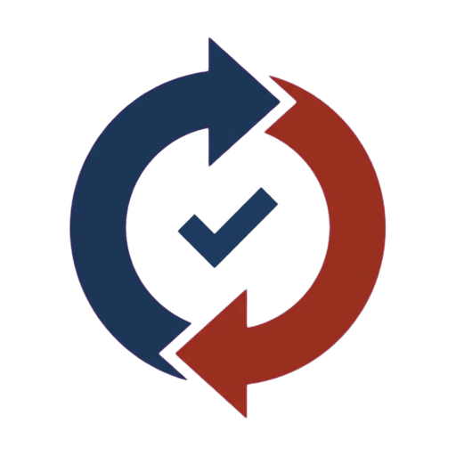

# QuoteLoop

**Demo video:** https://youtu.be/INprGHdylvE | **Hosted demo:** https://quoteloop.35-216-2-121.sslip.io | **Devpost:** https://devpost.com/software/quoteloop

The hosted demo (no login) runs live Claude Sonnet (`claude-sonnet-5-5`) for both agents, with per-IP-hour and per-day caps. When the API fails or a cap is hit, it falls back to a labelled recorded run or a rule-based stand-in. PayPal on the host is the bundled mock process (`/api/health` reports `paypal: mock`).

Maya buys supplies for 12 cafes (a demo persona), and her reorders still start with quotes that go back and forth by email. QuoteLoop gives her company and its supplier one AI agent each: the two agents negotiate the quote by signed messages and settle it on PayPal (saved PayPal account, invoice, capture) without a human click inside her limits. You can trust it because code, not the model, holds the money rules: an invoice that differs from the agreed quote is never sent, every charge carries her agent's co-signature for that exact amount, and her agent checks PayPal's own records for any charge without one.

Two words used below: a **mandate** is the signed rule sheet her company gives its agent (price caps, items, budget, approval limit); a **co-signature** is her agent's one-time signature on one charge (amount, payee, invoice, 10 minute expiry).

Built for the PayPal AI Hackathon 2026 (Best Use of Agentic Commerce).

## The story

Maya buys supplies for 12 cafes. Her company signs one **mandate** (price caps, allowed items, over-order limit, auto-approve limit, budget, expiry) and saves its procurement PayPal with the supplier, once. After that, her buyer agent and the supplier's sales agent negotiate by signed messages. The supplier drafts a PayPal invoice, the buyer's code checks the draft line by line against the signed quote, and only then does the buyer agent co-sign the exact amount. The supplier checks the co-signature, charges the saved PayPal, confirms the order, and marks the invoice paid. Above the auto-approve line, Maya decides. The agent still settles.

## What PayPal does and does not do here (honest scope)

PayPal does not see the mandate or the co-signature. QuoteLoop's checks are:

| Check | Who | When |
|---|---|---|
| Saved token valid, funds available | PayPal | at charge time |
| Draft lines and total equal the signed quote | buyer code | before the invoice is sent |
| Co-signature (amount, payee, invoice, quote hash, 10 minute expiry, one-time nonce) | supplier code (supplier-enforced) | right before the charge |
| Every outgoing charge in the buyer's own PayPal activity has a matching co-signature (verified on the bundled mock; on the sandbox our charges are listed with the co-signature hash and invoice number, seen from the supplier account, VERIFY 7 partial) | buyer code (buyer-audited) | after the charge (PayPal: "a maximum of three hours" before a charge is listed, [Transaction Search docs](https://developer.paypal.com/docs/api/transaction-search/v1/search-get/)) |

A supplier that bypasses its own code can still charge a saved token. The buyer's audit finds that charge in PayPal's activity (on the bundled mock today), pauses further co-signing and tells Maya. The step that would prevent it, PayPal verifying an AP2-style payment mandate on vaulted charges, is the next step we propose to PayPal.

## How it works

```
 browser (React, served by the buyer)
        |   SSE + JSON
 buyer service :4101  <------ signed messages (Ed25519 JWS over HTTP) ------>  supplier service :4102
 own DB, own key, own PayPal credentials                                    own DB, own key, own PayPal credentials
 mandate, budget, co-signatures, audit                                      price list, floors, stock, quotes, vault token
        |                                                                            |
        +------------------------ PayPal (sandbox, or the bundled mock process :4103) -+
```

1. **Mandate**: Maya signs the mandate (AP2-inspired, `agent_recurrence: ON_DEMAND`). PayPal is saved with the supplier in a separate Vault "purchase later" flow.
2. **Negotiate**: `RFQ` -> `QUOTE` (options) -> `COUNTER` -> `QUOTE v2` -> `ACCEPT`, up to 4 rounds. The supplier's concession schedule (0% / 2% / 3%), floor price and stock are in the supplier's code. The buyer's rules are in the buyer's code: filter by cap, over-order limit and budget, then use the pay-now lever, then accept under the reference price or ask for approval.
3. **Draft**: the supplier creates a PayPal invoice **draft** and sends a signed copy of PayPal's own JSON to the buyer.
4. **Verify**: the buyer checks every line, price, discount, total, PO, terms, recipient and number. A mismatch (for example an unquoted "Rush handling $40.00" line) means `DRAFT_REJECT`: the draft is deleted, nothing is sent, nothing is charged.
5. **Co-sign**: the buyer signs `{payee, amount, invoice, quote hash, nonce, expiry}` for that verified draft.
6. **Charge**: the supplier verifies the co-signature, sends the invoice (without email), creates an Orders `CAPTURE` with `payment_source.paypal.vault_id`, `custom_id` = co-signature hash and `invoice_id` = invoice number, reads the order back (COMPLETED, capture id) and records the payment on the invoice.
7. **Audit**: the buyer reads its own PayPal activity and pairs charges with co-signatures. Refunds coming in are not charges.

### Demo numbers (tests reproduce them)

Request: 2 cases of 12oz cups. Round 1 quotes: a = 2 x $128.00 (NET_30), b = 3 x $118.00.

| Mandate | What the rules do | Result |
|---|---|---|
| A Lean (cap $130, reference $127, over-order 10%) | b is filtered (+50% quantity, +38% spend, limit 10%); pay-now counter on a; round 2 gives 2% off plus 2% pay-now | **2 cases, $245.86** ($122.93 net per case), accepted automatically |
| B Bulk (cap $125, reference $127, over-order 60%) | a is above the cap; b stays; pay-now counter on b | **3 cases, $339.98** ($113.33 net per case), saves **$14.02** against accepting round 1 ($354.00) |

A $1,180 grinder part is above the $500 auto-approve limit: an approval card, then the agent settles after Maya approves.

## Run it

Requires Node 22.13 or newer (uses the built-in `node:sqlite`).

```bash
npm install
npm run build        # builds the web page into dist/
npm start            # starts mock PayPal :4103, supplier :4102, buyer :4101
```

Open http://localhost:4101. With no keys, nothing leaves your machine: PayPal runs as a separate mock process with the same REST paths and response shapes, and both agents run their rules in policy mode. To use a real PayPal sandbox or Claude, start from a fresh copy of `.env.example` (`cp .env.example .env`, or keep it under another name and start with `ENV_FILE=that-file npm start`) and fill the variables in the table below. The buyer's first log line names the settings file it read and warns if a mock wait is longer than 10 minutes, which usually means an old `.env`. `VERIFY.md` lists the sandbox checks.

### Sandbox demo mode

Set `FORCE_MOCK=0`, the supplier and buyer sandbox keys, and `SUPPLIER_PRESET_VAULT_ID` (a payment token saved once through the Connect PayPal tab) with `SUPPLIER_PRESET_VAULT_PAYER_EMAIL` listed in `SUPPLIER_JUDGE_PAYER_EMAILS`, so judge charges are refunded automatically. The page header then says the supplier PayPal mode is `sandbox`, and the PayPal activity tab says it read the PayPal sandbox. If the buyer and the supplier share one sandbox REST app (as in our test set-up), also set `BUYER_ACTIVITY_SIDE=payee`: the audit then reads the supplier account's records, flips the signs and checks only rows that carry a QuoteLoop invoice, co-signature or demo tag, and the tab says so.

### Environment variables

Nothing is required. The defaults run everything on the bundled mock. The full table is in [`docs/CONFIG.md`](docs/CONFIG.md), and `.env.example` has comments.

Run the services separately if you prefer: `npm run start:mockpaypal`, `npm run start:supplier`, `npm run start:buyer`.

To start in the exact state the video uses (fresh database, bundled mock, no keys): `npm run demo:video`. The scene list is in [`docs/VIDEO_SCRIPT.md`](docs/VIDEO_SCRIPT.md), the Devpost text in [`DEVPOST.md`](DEVPOST.md).

## Testing instructions (for judges)

Every visitor gets their own budget, deals and alerts (a server-issued cookie), and judge-account sales never use up the shared stock, so these steps give the same numbers each time and for each person.

**The 3-minute path is steps 1 to 6** (deal, mandate B, approval card, blocked draft, audit alert). Steps 7 to 11 show the rest.

1. Open the demo (to run it yourself: `npm install`, `npm run build`, `npm start`, then http://localhost:4101). The first screen is ready: mandate **A Lean** is signed and the judge PayPal account is already saved with the supplier. No PayPal login is needed.
2. Press **Run deal**. Read the left (buyer) and right (supplier) panes: option b is filtered by the over-order rule, the buyer counters with pay-now, accepts at **$245.86**, and the settlement list shows VERIFY MATCH, CO-SIGN, the charge and the invoice marked PAID. A judge-account charge is refunded automatically a few minutes later (2 minutes on the bundled mock, 10 minutes on the sandbox; the settlement list shows the time; sandbox refunds were verified COMPLETED, VERIFY 11). The same list says when the charge shows in PayPal activity (2 minutes on the bundled mock, up to 3 hours on PayPal).
3. Switch the mandate to **B Bulk** and run again: 3 cases, **$339.98**, "Saved $14.02". Open the **Compare A vs B** tab.
4. Type `Grinder burr set, 1 unit` as the request (or pick it under Examples) and run: an approval slip appears for $1,180.00. Press **Sign and approve**, and the agent verifies, co-signs and settles.
5. Open **Demo controls**, press "Add a Rush handling line to the next draft", run a deal: the buyer blocks the draft, it is deleted at PayPal, nothing is charged.
6a. In **PayPal activity**, press Check. Yesterday's deal shows as refunded. Yesterday's $19.99 charge has no co-signature, so it raises an alert and pauses co-signing. Press **Resume** to acknowledge it for good.
6b. Press "Charge $19.99 with no co-signature" in Demo controls. The page tells you when it will show up (2 minutes on the bundled mock, up to 3 hours on a real sandbox). Press Check again then. The table shows only your own charges and the shared seeded history, and says if it read the mock or the PayPal sandbox. Other visitors' charges are counted in one line below it.
7. Press **Buyer with no agent**: a person opens the supplier's quote link and pays through PayPal (the mock approval page in the bundled demo, PayPal's sandbox page when sandbox keys are set, which needs a sandbox payer login).
8. If the daily live-run limit (3 per visitor, 60 in total) or the judge account minimum balance is reached, the same flow runs on simulated PayPal calls and the page says so.
9. Open the **Price list** tab: the supplier's tiers, floor, stock and concessions. Editing needs the owner token, so the public demo shows it read-only.
10. When a model is available (the hosted demo runs live Claude Sonnet under its caps; the Agents menu shows the model in use), type a free-form sentence such as `We are running low on hot cups, please get us two cases of the 12oz ones by Friday` and run it. The buyer pane lists the tool calls the model chose, in order. Press "12oz hot cups low on stock (this visitor only)" first to see the supplier model offer a recycled-cup substitute. When the caps are hit or the API fails, the same tools run by rules ("Rules (fallback, same tools)"), and the **Claude runs** tab replays three real runs recorded on 2026-11-12, labelled "Recorded run: Claude Sonnet, 2026-11-12", with their real tool order and timings.
11. Open the **Sandbox evidence** tab: the PayPal sandbox checks that passed on 2026-11-12, with their VERIFY numbers and PayPal ids, and the ones that did not pass.

## Where AI is used

- Two Claude tool loops, one per service, in separate processes (`buyer/agent`, `supplier/agent`). They run on the Messages API with an API key (`@anthropic-ai/sdk`) or, locally, through the developer's own Claude Code login (`LLM_BACKEND=account`, `@anthropic-ai/claude-agent-sdk`, the API key variables are removed from its environment). Model: `claude-sonnet-5-5`.
- Free-form request: in Claude mode the buyer model receives the sentence the person typed plus the mandate id, reads it, and passes the item and the number of cases to `send_rfq`. Code then checks the sku against the catalog and the mandate and requires the quantity to appear in the sentence. In rules mode a fixed word parser (`buyer/request.js`) does this step.
- The buyer model reads quotes and picks the moves; the supplier model maps requests to the catalog and proposes a same-category substitute when an item is short.
- The model never writes an amount. Supplier tools price from the price list, the round's concession and the floor, and take option ids. Buyer tools take option ids and levers. `accept_quote` re-checks every mandate rule whoever picked the option, and `cosign_charge` refuses unless `verify_draft` passed. Text from the other agent arrives as an untrusted note, never as an instruction.
- Rules mode runs the same tools with code rules; tests prove it gives the same deals as a scripted model that follows `evaluate_quote`. If a model call fails, the deal carries on with the same tools run by rules and the page says so.
- Real model runs (2026-11-12, Claude Sonnet through a local Claude Code login, not an API key, bundled mock PayPal): the free-form request ended at $245.86 with the tool order `read_mandate`, `discover_supplier`, `send_rfq`, `evaluate_quote`, `counter`, `evaluate_quote`, `accept_quote`, `verify_draft`, `cosign_charge`; with hot cups low on stock the supplier model quoted CUP-12-RECYCLED as a substitute and the buyer model bought it at $265.07. Two deals, both agents on the model. The hosted demo now runs the same loops live through the API key. Details in `VERIFY.md` (M1, M2).
- Recorded runs shipped with the app (`builtin/recorded-runs/*.json`, made by `npm run record:runs` on 2026-11-12, account login, bundled mock PayPal): M1 free-form request ($245.86, 2 cases), M2 substitute (2 cases of recycled cups, $265.07), M3 the same kind of request under mandate B (3 cases, $339.98). Each file keeps both models' tool calls in order, the text they wrote and the timings. When no live model is available (cap reached or API failure), the page replays them labelled "Recorded run: Claude Sonnet, 2026-11-12" and never presents rules as a model.

## PayPal APIs used

With sandbox keys the Vault, Orders, refund and Transaction Search calls go through the APIMatic-generated SDK; Invoicing and Catalog go through REST or the PayPal Agent Toolkit. With no keys everything goes to the bundled mock.

| Step | Through | API |
|---|---|---|
| Product catalog | Toolkit | `create_product` |
| Save PayPal with the supplier (separate from checkout) | APIMatic SDK | Vault v3: `POST /v3/vault/setup-tokens` (`usage_type: MERCHANT`), payer approval, `POST /v3/vault/payment-tokens` |
| Invoice draft | REST and Toolkit | `POST /v2/invoicing/invoices` (term, item discount); `generate_invoice_number`, `get_invoice`, `delete_invoice`, `send_invoice` |
| Charge | APIMatic SDK | Orders v2 `orders.createOrder` with `vault_id`, `invoice_id`, `custom_id`, `PayPal-Request-Id` = co-signature nonce; `GET` order |
| Invoice paid (webhook) | REST | `POST /v1/notifications/verify-webhook-signature`, then the invoice is read back; handles `INVOICING.INVOICE.PAID` at `POST /webhooks/paypal` (VERIFY 16) |
| Invoice paid | Toolkit | `record_payment_for_invoice` with `method: OTHER` and the capture id in the note (the sandbox does not accept an Orders capture as method PAYPAL, VERIFY 6) |
| Buyer audit | APIMatic SDK | `transactionSearch.searchTransactions` (permission granted 2026-11-12: VERIFY 10, 12 PASS, 7 partial) |
| Judge account restore | APIMatic SDK and Toolkit | `payments.refundCapturedPayment`; Toolkit `record_refund_for_invoice` |
| Person without an agent | APIMatic SDK | Orders v2 with PayPal approval, then capture |

## Sandbox results (VERIFY, 2026-11-12)

The same list is in the app's **Sandbox evidence** tab (`builtin/sandbox-evidence.json`; a test checks it against `VERIFY.md`).

Passed on the PayPal sandbox: Vault setup and payment tokens for a personal and a business payer (1, 2, 3); a vaulted Orders capture with no payer present (4: order 1ST51304L6128915T, capture 2BG67109PE226381Y; in-app deals Q-0044: order 6J566139G5956301J, capture 7UE89006K1324024J, and Q-0046: order 5M8367836C9634727, capture 4H098055JS548532U); a repeated `invoice_id` is refused with DUPLICATE_INVOICE_ID (5); invoice draft send without mail, a blocked draft deleted (INV2-LQCR-2EBU-GPLP-55A2) and item discounts summing to the quote total (9); the same PayPal-Request-Id returns the same payment token, order and refund (13); the SDK defaults are accepted (14); `Prefer: return=representation` returns the capture (15); three refunds COMPLETED (11, partial); the Transaction Search permission and the SDK reads of balances and transactions (10, 12). In-app sandbox run the same day: deals Q-0042 (capture 6ET89834W30050123) and Q-0043 (capture 2J9177124Y098483N) for two visitors, and a demo charge with no co-signature (capture 0XD347862X366022X, refunded automatically 2MC14494EH704741Y).

Not as hoped, stated as is: recording the payment on the invoice with method PAYPAL and an Orders capture id answers 404, so the app records it with `method: OTHER` and the capture id in the note (6). Transaction Search first answered 403; after the permission was granted the same day the token carries the reporting scope and the SDK reads balances and transactions (10, 12 PASS). Our only sandbox REST app belongs to the supplier, so the audit was run from the supplier account's side (`BUYER_ACTIVITY_SIDE=payee`): earlier charges 7UE89006K1324024J and 4H098055JS548532U are listed with the co-signature hash as `custom_field` and the invoice number; the newest run's charges had not been listed yet when we stopped (PayPal: up to 3 hours), and a payer-owned app was not available, so 7 is partial. The payer balance after a refund (11) is still not compared: the payer has no REST app. A payer with a linked bank and card was charged above its PayPal balance, funded from the bank or card (8); the write-up makes no claim about balance limits.

## Built with the APIMatic Context Plugin

The PayPal calls were moved to the APIMatic-generated PayPal TypeScript SDK (package `paypal`, client `PaypalClient`, installed from `github:context-plugins/paypal-typescript-sdk#main`, not on npm) using the APIMatic Context Plugin skills `typescript-integrate-paypal`, `typescript-getting-started`, `typescript-error-handling`, `typescript-client-initialization`, `typescript-configuration-resilience` and `typescript-testing`. The contract sheet (fields, channels, durable-write claims, unknown-outcome handling, error table) is in [`paypal-plan.md`](paypal-plan.md).

- Through the SDK (when sandbox keys are set): Vault v3 setup token and payment token, Orders create / capture / get, refund of a captured payment, Transaction Search (transactions and balances). Code: `shared/paypalSdk.js`.
- Kept on REST or the PayPal Agent Toolkit, because the SDK has no such resource: Invoicing (draft, number, get, send, delete, record payment, record refund) and Catalog products.
- The default run (no keys) still uses the bundled mock PayPal process through the same adapter interface, so the SDK is used only against a real sandbox credential. The SDK adapter is tested with a faked `fetch` and against the local mock.
- Every durable write has a claim row (`paypal_claims`, `cosigns`, `refund_jobs`) written before the request leaves, and a lost answer is re-read with the same `PayPal-Request-Id`, never reported as failed.
- Sandbox results (2026-11-12): Vault setup and payment tokens, a vaulted Orders capture with no payer present, PayPal-Request-Id replay, the SDK defaults and the Transaction Search reads (balances, transactions) passed through this SDK. Ids are in the Sandbox results section above.

## AP2 mapping (inspired by AP2, not the same structure)

| QuoteLoop | AP2 idea |
|---|---|
| Mandate: `checkout.allowed_merchants`, `checkout.line_items`, `payment.amount_range`, `allowed_payees`, `allowed_payment_instruments`, `budget`, `agent_recurrence` | Open Checkout Mandate and Open Payment Mandate |
| Signed quote hash in ACCEPT | Closed Checkout Mandate |
| Per-charge co-signature | Closed Payment Mandate |
| Difference | In AP2 the payment mandate is "verified by the Credential Provider, Network, and Merchant Payment Processor" ([AP2 Payment Mandate](https://ap2-protocol.org/ap2/payment_mandate/)); here PayPal does not see it, so supplier code verifies and the buyer audits. |

## Tests

```bash
npm test      # node:test, no network
npm run build
```

Covered: price and floor rules, the $245.86 and $339.98 deals and the $14.02 saving, over-order blocking, budget races, compare-and-set accept, draft change detection, forged / wrong-amount / expired / reused co-signatures, replayed messages, key pinning, mandate checks at the supplier, per-charge limit, NET_30 handling, refunds in the audit, pending vs matched under search lag, an alert that pauses co-signing, judge auto-refund, daily limits and low-balance fallback, scripted-model scenarios (substitute SKU, over-order pick, skipped verification), process and credential isolation (including three real OS processes), the person-with-no-agent path, per-visitor budgets and deals, identical numbers for every visitor and on repeat runs, audit alert acknowledgement and per-visitor pause, the co-signed daily check, release of the budget when co-signing is paused, the free-form request checks, the model fallback, the account backend adapter, the `INVOICING.INVOICE.PAID` webhook (signature, read-back, duplicate event), the price-list edit rules, one balance notice, the screens rendered with real deal data, the recorded Claude runs (tool order, no amount in any tool input, the README numbers), the in-app sandbox evidence checked against `VERIFY.md`, the short mock-mode waits, a quote-link payment by another business never raising an alert, and these docs (no placeholders, same step names, video under 2:50).

## Project layout

```
buyer/       mandate, rules (evaluate.js), draft check, co-signature, audit, deals, agent tools
supplier/    price list, pricing engine, quotes, vault, invoices, settlement, limits, refunds, agent tools
shared/      money (integer cents), JWS, signed messages, protocol schemas, PayPal client (REST/mock adapter and APIMatic SDK adapter), claims, document store
mockpaypal/  PayPal stand-in process (Vault, Orders, Invoicing, refunds, Transaction Search)
web/         React page (Vite)
test/        node:test suites
```

## License

MIT
